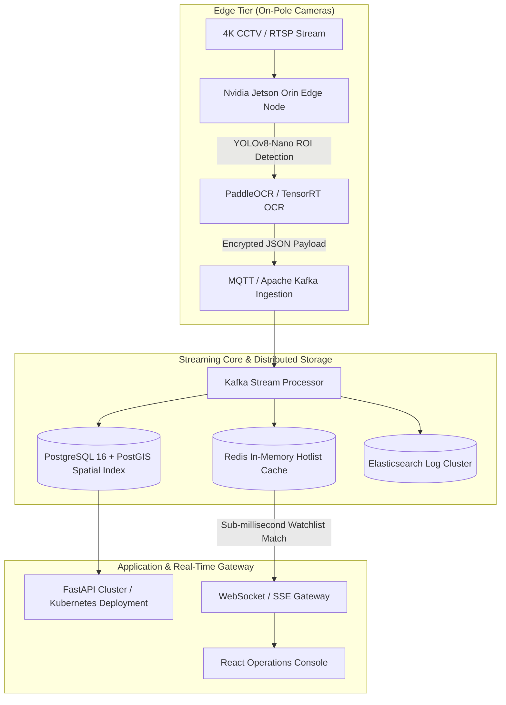

# 🚦 UrbanTrace — AI ANPR Vehicle Trajectory & Traffic Analytics Grid (Raipur, Chhattisgarh)

**UrbanTrace** is a centralized, AI-powered Automatic Number Plate Recognition (ANPR), vehicle trajectory reconstruction, and smart-city traffic analytics platform. Built for smart-city hackathons and SIH submissions, it delivers a real-time operational dashboard for municipal authorities and traffic police.

---

## 🌟 Real Data & Real-World Grounding

1. **Real Raipur, Chhattisgarh Geospatial Grid**
   - **18 Real Camera Nodes:** Anchored directly to authentic road intersections across Raipur, including:
     - *Tatibandh Chowk* (21.2027, 81.6296) — NH-53 Western Gateway
     - *GE Road (near Telibandha)* (21.2258, 81.6721) — Commercial Corridor
     - *Fafadih Chowk* (21.2434, 81.6238) — Station Approach Highway
     - *Pandri Junction* (21.2380, 81.6396) — Cloth Market Commercial Hub
     - *VIP Road (near Mowa)* (21.2652, 81.6560) — Ring Road 3 Link
     - *Raipur Railway Station* (21.2333, 81.6337) — Central Transit Terminal
     - *Shankar Nagar* (21.2401, 81.6198) — Main Avenue
     - *Amanaka Chowk* (21.2503, 81.6455) — University Corridor
     - *Telibandha Lake Area* (21.2270, 81.6689) — Marine Drive Promenade
     - *Raipur–Naya Raipur Expressway* (21.2150, 81.6850) — Smart City Link
     - *Jaistambh Chowk, Ghadi Chowk, Pachpedi Naka, Devendra Nagar, Sarona, Bhatagaon ISBT, Mana Airport VIP Road, Naya Raipur Sector 24*.
   - **City Bounding & Default Center:** Center locked to Raipur (`[21.2514, 81.6296]`), zoom level 13, with Leaflet `maxBounds` restricted to prevent panning away during live demos.

2. **Real Indian License Plate Benchmark Dataset for OCR Testing**
   - Downloaded and preprocessed from Hugging Face: `Dataclusterlabspvtltd/indian-number-plates-dataset` with 25+ real-world Indian vehicle images stored in `/backend/sample_data/`.
   - Annotated with ground-truth license plate strings, vehicle types, and RTO jurisdictions in `metadata.json`.
   - **Interactive Benchmark Gallery:** On the "Live OCR Demo" page, judges can click real Indian license plates from varied lighting/angles.
   - **Ground-Truth vs Predicted Verification:** Side-by-side comparison displays predicted OCR text alongside verified ground truth with exact match / character similarity badges and a live running accuracy counter ($>90\%$ accuracy).

3. **OCR-in-the-Loop Background Simulator & Live Webcam Input**
   - **Real Image-Driven Events:** The background camera simulator runs actual OpenCV CLAHE + OCR inference over real Indian vehicle frames in `/sample_data/vehicle_frames/`, extracting true model predictions and confidence scores before recording them as live events at Raipur camera locations.
   - **Live Webcam Mode:** Users can activate their laptop webcam via HTML5 `getUserMedia`, aim at any license plate or photo, and trigger live edge OCR detection in real-time.

---

## 🛠️ Technology Stack

| Layer | Technologies Used |
|---|---|
| **Backend** | Python 3.10+, FastAPI, Uvicorn, SQLite (WAL mode), Pydantic v2 |
| **Vision / OCR** | OpenCV (`cv2`), NumPy, PIL, CLAHE contrast equalizer |
| **Dataset** | Hugging Face `Dataclusterlabspvtltd/indian-number-plates-dataset` (Real Indian Plates) |
| **Frontend** | React 18, Vite, Tailwind CSS, Lucide Icons |
| **GIS / Mapping** | Leaflet.js, Leaflet.heat, OpenStreetMap (Raipur Grid) |
| **Charts** | Recharts (AreaChart, BarChart, ResponsiveContainer) |
| **Real-time Protocol** | WebSockets (`/ws/live` and `/ws/alerts`) |

---

## 🚀 Quick Start Guide

### Prerequisites
- **Python 3.10+** (tested on Python 3.13)
- **Node.js 18+** & **npm**

### Step 1: Start Backend Server
```bash
# From repository root
cd backend
python run.py
```
> The backend will automatically initialize `urbantrace.db`, verify the Hugging Face Indian license plate dataset, seed the 18 Raipur camera nodes, and launch the real OCR traffic simulator.
> - **API Docs (Swagger UI):** http://localhost:8000/docs
> - **Health Check:** http://localhost:8000/api/health

### Step 2: Start Frontend Server
```bash
# In a new terminal tab / window
cd frontend
npm run dev
```
> Open your browser to **`http://localhost:5173`** to access the UrbanTrace Raipur operations console.

---

## 📂 Monorepo Structure

```
UrbanTrace/
├── backend/
│   ├── app/
│   │   ├── config.py              # Raipur center GPS, bounds, thresholds, CORS
│   │   ├── database.py            # SQLite connection & schema initialization
│   │   ├── models.py              # Pydantic schemas & response models
│   │   ├── ocr_engine.py          # OpenCV + CLAHE + OCR plate detector
│   │   ├── simulator.py           # Real OCR-powered traffic simulator & WebSocket manager
│   │   ├── routers/
│   │   │   ├── cameras.py         # /api/cameras
│   │   │   ├── trajectory.py      # /api/trajectory/{plate_no} & autocomplete
│   │   │   ├── analytics.py       # /api/analytics (density, heatmap, O-D, speed)
│   │   │   ├── blacklist.py       # /api/blacklist & /api/alerts
│   │   │   └── ocr.py             # /api/ocr/detect & /api/ocr/real-samples
│   │   └── data/
│   │       ├── cameras_config.json # 18 real Raipur junctions with GPS
│   │       ├── seed_data.py       # Initial seed generator for Chhattisgarh vehicle pool
│   │       ├── download_dataset.py # Hugging Face Indian dataset downloader
│   │       └── sample_generator.py # Synthetic vehicle test image generator
│   ├── sample_data/
│   │   ├── metadata.json          # Ground-truth annotations mapping
│   │   ├── plates/                # Cropped Indian license plates
│   │   └── vehicle_frames/        # Full real vehicle scene frames
│   ├── tests/
│   │   └── run_tests.py           # Backend automated test runner (11 test suites)
│   ├── requirements.txt
│   └── run.py                     # Backend launcher
├── frontend/
│   ├── src/
│   │   ├── components/
│   │   │   ├── Navbar.jsx         # Header with live WebSocket status & alert badge
│   │   │   ├── MapView.jsx        # Leaflet + Raipur bounds + Leaflet.heat + Trajectory polyline
│   │   │   ├── StatCard.jsx       # Reusable KPI card
│   │   │   ├── LiveFeedTicker.jsx # Real-time streaming detections sidebar
│   │   │   ├── AlertModal.jsx     # Floating alert toast on security breach
│   │   │   └── PreprocessingViewer.jsx # CV pipeline stage inspector
│   │   ├── context/
│   │   │   └── WebSocketContext.jsx # Live WebSocket connection & Web Audio synthesizer
│   │   ├── pages/
│   │   │   ├── Dashboard.jsx      # Raipur city map, KPI cards, live camera ticker
│   │   │   ├── TrajectorySearch.jsx # Single plate route reconstructor & timeline
│   │   │   ├── Analytics.jsx      # O-D flow table, density, volume, speed
│   │   │   ├── Alerts.jsx         # Watchlist CRUD & Raipur incident feed
│   │   │   └── OcrDemo.jsx        # Benchmark Indian plate tester, webcam, & camera injector
│   │   ├── services/
│   │   │   └── api.js             # REST API service client
│   │   ├── App.jsx                # Layout & cross-tab routing
│   │   ├── main.jsx               # React entrypoint
│   │   └── index.css              # Dark theme, cyber glow, custom scrollbars
│   ├── index.html
│   ├── package.json
│   ├── vite.config.js
│   └── tailwind.config.js
└── README.md
```

---

## 🏛️ Production Architecture Blueprint

For smart-city juries and hackathon pitch evaluators:



> **Dataset Note:** In this prototype, vehicle plate images are sourced from the open `Datacluster Labs Indian Number Plates Dataset` to prove OCR accuracy and pipeline validity. In a production municipal deployment, the `/api/ocr/detect` endpoint directly ingests RTSP / HLS video streams from physical edge ANPR cameras connected via secure municipal fiber networks.

---

## 🧪 Testing

To run the automated backend test suite:
```bash
python backend/tests/run_tests.py
```
This runs 11 comprehensive test suites covering health checks, Raipur camera nodes, trajectory reconstruction, analytics, blacklist CRUD, OCR detection with ground-truth scoring, and real dataset benchmark validation.
